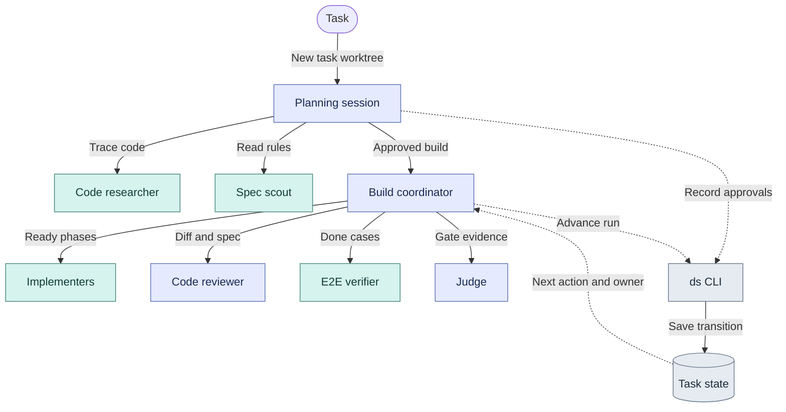
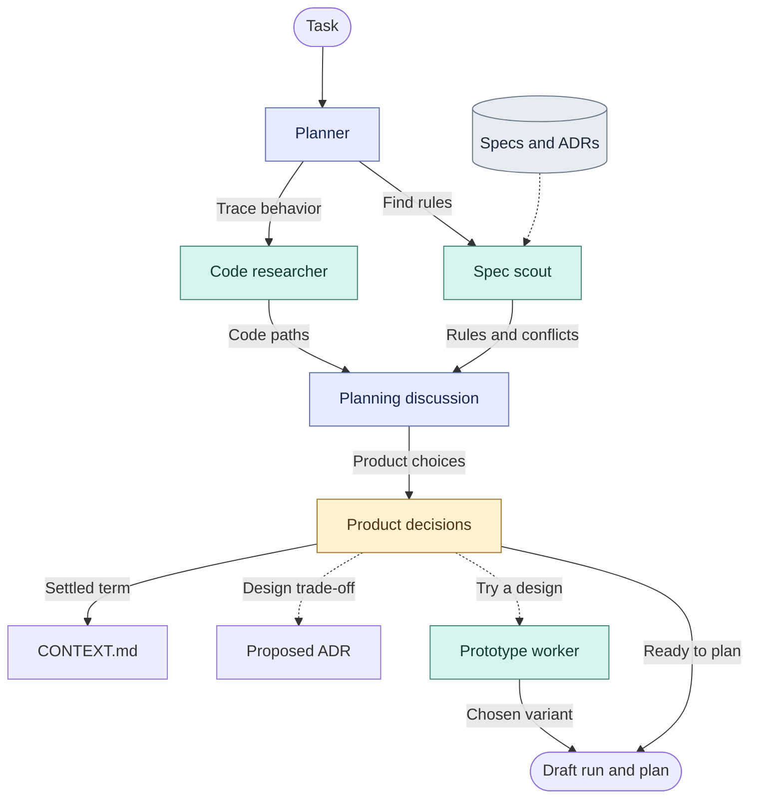
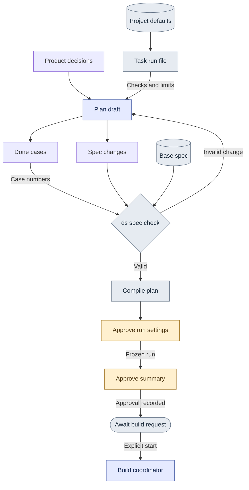
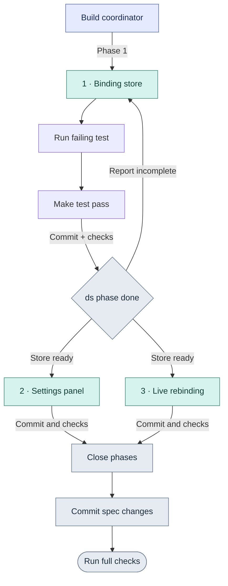
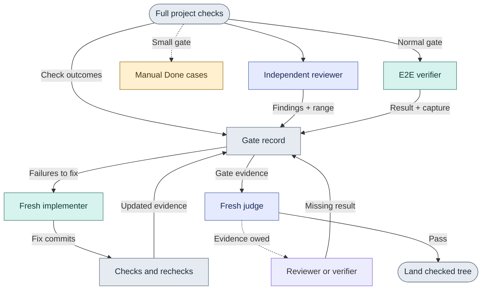
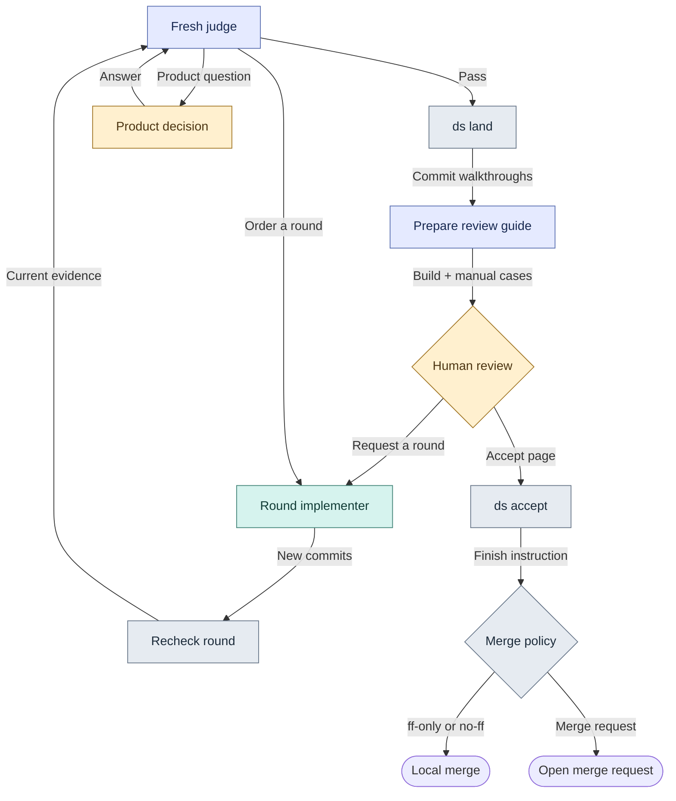

# dev-skills

**dev-skills runs a deterministic development workflow from your preferred coding agent.** Its local CLI, `ds`, keeps the state of each task from planning through merge. Agents build against the plan you approved. The CLI records which commits the reviewer examined, which build the verifier tested and which version you accepted for merge.

Choose a **primary** model for planning, coordination and independent judgment, and a **secondary** model for scoped work such as research, implementation and verification. If you close the chat during a build, a fresh session in the task worktree can read which phases finished, which commit was reviewed and whose decision is pending. Ask it to **“continue this task with ds.”**

[Install](#install) · [Quick start](#quick-start) · [How it works](#how-it-works) · [Features](#features) · [Workflow stages](#workflow-stages) · [Examples](#examples)

## Install

On macOS or Linux, you'll need Bash, Git, curl and Python 3.11+ on your PATH as `python3`. Install the `ds` CLI once on your machine.

```sh
curl -fsSL https://raw.githubusercontent.com/bmox0/dev-skills/main/install.sh | bash
export PATH="$HOME/.local/bin:$PATH"
ds --version
```

Keep the export in your shell profile if needed. From your project's Git checkout, use Node.js and `npx` to install the entry skill for your coding agent.

```sh
npx skills add https://github.com/bmox0/dev-skills/tree/main/ds-cli-skill
```

If the project already has runs from the native plugin, follow the [migration guide](docs/cli.md#migrate-from-the-legacy-plugin) before initialization.

## Quick start

**1. Set up a project.** Run the initializer in a Git repository with at least one commit.

```sh
ds init
```

Select your provider and model pair, optionally set their reasoning effort, and enter the project’s check commands and merge policy. Commit `.ds/config.toml`, `.ds/ds.lock`, the generated changes to `AGENTS.md` and `.gitignore`, and the project skill and its lockfile. New task worktrees will have the same setup.

**2. Describe a change.** Open a fresh agent session in the project and describe the task.

> Use ds to start a task called export-csv. Add a Download CSV button to the reports page. Export the rows that match the current filters. Disable the button when there are no rows.

The agent starts the task on branch `ds/export-csv` and works with you on the plan. If filters include a date range, for example, agree on a test that would catch rows outside it. Approve the run settings and plan summary, then tell the agent to build.

**3. Try the result.** The review guide tells you how to open the build and what to check. For this export, download a filtered report and try a date range with no rows. You can request another round, or accept the result and tell the agent to finish. Depending on the project settings, finish merges locally or opens a merge request.

## How it works

### Bring your own coding agent

Install one entry skill and say **“Use ds”** in the agent you already use. The skill runs `ds help agents` to read the installed workflow. Your agent client runs shell commands and dispatches workers with the model and effort named in their briefs. You can use a native agent session, a separate herdr tab or a manual handoff. Each uses the same CLI, project checks and task state. [Session handoff](references/SESSIONS.md)

The planning session and build coordinator use **primary** for decisions that affect the whole change. **Secondary** workers get a bounded assignment, such as tracing a code path, implementing one phase or rerunning a failed case. A fresh primary model handles the first review and every judge verdict. Project profiles live in `.ds/config.toml`. Inspect one with `ds executor show --provider NAME`.



### What survives a handoff

`ds task start` records the branch, worktree and workflow release. When the planner compiles the plan, `ds` writes a JSON state file beside it under `.ds/workflow/plans/`. Approvals, phase reports, commits, check outcomes, review findings, verdicts and acceptance accumulate against that task. The CLI uses those records to render the review page and issue the next worker’s brief.

If a session closes during a full test run, the next coordinator can ask `ds` about that run. While its test processes are alive, `ds` tells the coordinator to wait. Once they stop, it can retry the interrupted check or reuse a completed result from the same cycle for the same commit and check commands. If it cannot determine whether the original processes are still running, it asks for that fact before starting another run.

Run `ds status --current` in the worktree to see the next action and its owner. For automation, add `--json`. The result distinguishes a command to run, work to assign, a decision to request and a reason to wait. [CLI actions](docs/cli.md#workflow-actions)

## Features

| Feature | What you get |
| --- | --- |
| **Isolated tasks** | Each task has a branch, worktree and artifact directory. A project can also allocate a port and data directory per task. |
| **Versioned product rules** | Each plan identifies the rules it changes. The resulting `docs/spec/` files travel with the code, ready for the next task’s spec scout. |
| **Parallel builds** | The planner assigns files and dependencies to each phase. If two phases claim overlapping paths, `ds` requires a dependency between them. Independent phases can start together. |
| **Verification follows the diff** | A small gate includes full project checks and code review. If the diff reaches beyond the paths assigned or granted to the phases, `ds` raises the gate to normal. The coordinator then dispatches a verifier for the applicable end-to-end cases. Generated changes under `docs/spec/` are exempt. |
| **Reviewable commits** | Before reorganizing the working commits, `ds land` creates a backup branch. It compares the resulting Git tree with the checked tree. If a commit hook changes a file, the judge can restore the backup or keep the difference with a reason that appears on the review page. |
| **Pinned workflow releases** | The project lock selects the engine and instructions for new tasks. An existing run keeps its release when a teammate updates the project. |

## Workflow stages

Run `ds workflow` to see the stages. During a task, `ds status --current` shows the current stage, who owns the next action and what they can do.

[Grill and prototype](#grill-and-prototype) · [Plan and approvals](#plan) · [Build by phase](#build) · [Verification and judge](#build-verification-and-judge) · [Human review and finish](#human-review-and-finish)

### Grill and Prototype



When a task needs a Grill, the **code researcher** traces the behavior through the repository and brings back file paths, existing interfaces and where the change would fit. The **spec scout** reads the relevant rules in `docs/spec/`, brings back the reason for each, and flags conflicts with the request, the code or an architecture decision record (ADR). For the CSV example, the researcher might find where the page applies its date filter. The scout checks whether the project already defines which rows an export includes. You decide what should happen if the two disagree.

As terms settle, the planner records them in the project glossary, `CONTEXT.md`. When an architectural choice involves a trade-off that would be costly to reverse and hard to understand later, the planner offers to record an ADR. If a design question remains, you can ask a secondary worker for a throwaway prototype before planning. [Grill](skills/grill/SKILL.md) · [Glossary and ADRs](skills/domain-modeling/SKILL.md)

### Plan



1. **Set the terms of the run.** The planner starts from the project defaults in the task’s `.run.toml`. You settle the model settings, phase and full-project checks, fixtures or accounts needed for verification, and how the branch will be integrated. [Example run file](skills/run-file/references/example.run.toml)
2. **Write the plan and its spec changes.** Each phase names the files it may change, the existing spec areas it must respect, the checks to run and which phases it depends on. A secondary researcher identifies the relevant code and project instructions. In the plan’s `## Spec`, the planner records lasting rules to add (`+`), change (`~`) or remove (`-`), or writes `none`. The numbered **Done** cases describe an action and the result someone can observe.
3. **Validate, approve and hand off.** The planner runs `ds spec check` against the base revision. You approve the run settings, then a linked summary of at most 350 words. Its approval covers the plan, spec changes and summary text for that run. If the planner edits an acceptance criterion afterward, `ds` requires renewed summary approval. Your separate instruction to build starts the handoff. [Example approval summary](skills/plan/references/resume.example.md)

For example, the keyboard-shortcuts plan adds `settings#taken-blocks`. It gives the reason a duplicate binding must be rejected and links the rule to Done case 2. That case tells the verifier to record an occupied shortcut, check that the UI names the conflicting action and confirm that Save is disabled. [Worked plan and spec](skills/plan/references/example.md)

### Build



The diagram follows the [keyboard-shortcuts plan](skills/plan/references/example.md). The coordinator starts a secondary implementer for each phase whose dependencies are met. They share the task worktree and write within their assigned files.

Each implementer follows **test-driven development (TDD)**. They write one test where the behavior is observable, run it to see the expected failure, make it pass, then run neighboring tests and the phase’s configured checks. A test covering a Done case cited by a spec rule carries that rule’s ID. [TDD cycle](skills/tdd/SKILL.md)

Before closing a phase, `ds phase done` checks the report against Git. The reported commits must be on the task branch after its base and touch only paths assigned or granted to the phase. Those paths must be clean, and the report must give an outcome for each configured check.

### Build verification and Judge



When the phases finish, `ds` applies the plan’s spec changes to `docs/spec/` in the task branch, commits the updated rules and runs the full project checks. The coordinator then assigns two distinct jobs at a normal gate.

| Subagent | Assignment | Evidence |
| --- | --- | --- |
| **Code reviewer · primary** | Read the diff against the approved plan, project conventions and applicable spec rules. | Findings and an explicit completion record for the commit range, even when the reviewer finds nothing. After a fix, `ds` uses the recorded coverage to determine which range needs review. |
| **End-to-end verifier · secondary** | In parallel with review, drive the assigned Done cases against the running system through the browser, simulator, HTTP or CLI. | A result for each case at the tested commit, with a capture or command output. A case the environment prevents the worker from reaching records why. |

At a small gate, full checks and the first code review still run. All Done cases go into your manual guide. Failed checks, defects and failed cases go to a fresh implementer on one fix list. The coordinator then runs the checks again and assigns targeted rechecks. [Verification levels and fixes](skills/build/references/gate.md)

A **fresh primary judge** reads the plan, findings and evidence. It can send a missing result back to the reviewer or verifier, request a round of changes, or ask you to resolve a product question. If successive rounds keep producing as many new issues, or a previously fixed check fails again, `ds` can stop further rounds. The review page shows why the rounds stopped and which findings remain open. When the branch is ready for human review, the judge prepares the commits and writes a walkthrough for each. [Judge](skills/build/references/judge.md)

### Human review and Finish



The build coordinator sends a guide in your conversation language with the exact worktree, URL or artifact to open. It lists each manual case as an action and expected result, plus any outstanding decision and what you would defer by accepting. In the CSV example, you can try an empty date range and decide whether a hang on exports over 10,000 rows needs a fix before merge. [Example review guide](skills/build/references/example.guide.md)

The page also lists decisions agents recorded during implementation, why they chose each option and what it would cost if they were wrong. You can request a round and receive a new guide after the fixes, rechecks and fresh verdict.

Your acceptance applies to that page and its landed commit. On your instruction, `ds finish` checks the branch tip, verdict, evidence and acceptance again before merging locally or opening a merge request. If someone adds a commit after you accept, the revised build goes through review and acceptance again.

## Examples

### Start and resume a task from the terminal

```console
$ ds task start export-csv
[…]
Tree: /Users/alex/src/reports/.ds/workflow/trees/export-csv
Plan: /Users/alex/src/reports/.ds/workflow/plans/export-csv.md
Artifacts: /Users/alex/src/reports/.ds/workflow/artifacts/export-csv
[…]
Next:
  User and planner — Continue in the task worktree with a grill or plan. [work]
```

Open your coding agent in the printed `Tree` and ask it to plan the export. From the project, use the task list or resume by name.

```sh
ds status                    # List tasks in the project
ds task resume export-csv    # Show this task's worktree and next step
```

### Read a plan or review guide

- **Keyboard shortcuts.** Read the summary you would approve, then open the full plan to see why the Settings panel and live rebinding can be built in parallel. [Approval summary](skills/plan/references/resume.example.md) · [Full plan](skills/plan/references/example.md)
- [CSV export review guide](skills/build/references/example.guide.md) — see what to download, what to expect for an empty date range and how an unresolved defect appears for your decision.
- [Project configuration](skills/run-file/references/project-config.md) — initialize from a script and configure per-task setup.
- [CLI reference](docs/cli.md) — update or repair a release, migrate existing runs or read the next actions as JSON.
